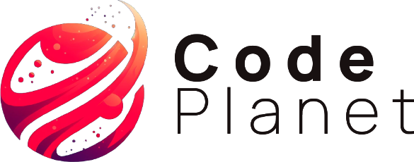

# Eduardo de Araújo

Sou **Eduardo de Araújo**, CEO da **Code-Planet**. Minha experiência técnica inclui desenvolvimento de software, sistemas Linux e computação em GPU. Trabalho com C e Python, compilação com CMake e validação de código em hardware real.

## Projetos

No [OSCDA](https://github.com/eusoupremissa/OSCDA), trabalho na compatibilidade de kernels CUDA com GPUs AMD no Linux. Minhas contribuições incluem a tradução de PTX para AMDGPU, a integração com ROCm e HIP, o carregamento de código GPU embutido em executáveis e a validação de resultados na Radeon RX 6600.

<picture>
  <source media="(prefers-color-scheme: dark)" srcset="assets/logo-dark.png">
  <source media="(prefers-color-scheme: light)" srcset="assets/logo-light.png">
  
</picture>
